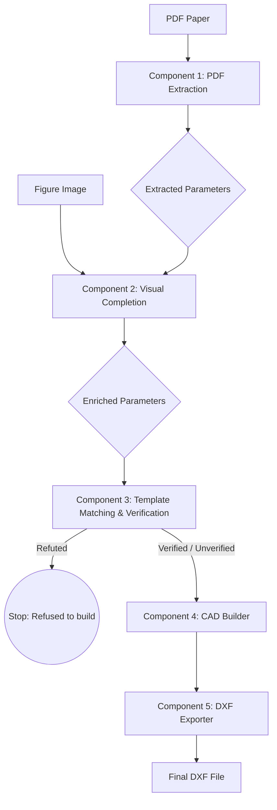

# 1. Pipeline Identity
- **Project/Pipeline Name**: Antenna Reconstruction Pipeline (`template_pipeline.TemplatePipeline`)
- **Purpose**: Reconstructs exact 2D antenna planar geometry from research papers (PDF text, parameter tables, and figures) into CAD-ready DXF files.
- **Problem Solved**: Automatically bridges the gap between scientific publications and electromagnetic solvers/CAD software by deterministically translating stated dimensions and shapes into rigorous 2D layouts.
- **Current Status**: Active/Current. Implements a "propose, then verify" architecture to ensure geometry is based on stated facts, not guesses.
- **Primary Entry Points**: 
  - CLI: `antenna-reconstruct`
  - Python: `main.py`
  - API: `TemplatePipeline.run_from_pdf` / `TemplatePipeline.run_from_parameters`
- **Primary Outputs**: DXF file (geometry) with layers per conductor, plus diagnostics logs and preview images.
- **Important Terminology**:
  - **Binding**: The mapping between a mathematical symbol (e.g., `W`, `L_g`) and its numerical value.
  - **Template**: A parametric definition of an antenna family (e.g., `rectangular_patch`, `hexagonal_ring_cpw_monopole`).
  - **Relation**: An arithmetic identity declared by a template that MUST hold true for a correct binding (e.g., `W1 = W/2 - FW/2 - G1`).
  - **Visual Completion**: Supplementing table-derived dimensions with structural topology identified from the paper's figures using a Visual Language Model (VLM).

---

# 2. High-Level Architecture



### Flow summary:
1. **PDF Extraction**: Reads the PDF, extracts parameter tables using word-coordinates to preserve cell grids, parses prose, and infers physics-derived metrics (like wavelength). Outputs `Dict[str, float]`.
2. **Visual Completion**: Takes the figure image and the extracted parameters. Sends them to a VLM to detect missing geometry features and uses a deterministic mathematical constructor to deduce derived coordinates/parameters. Outputs enriched `Dict[str, float]`.
3. **Template Matching & Verification**: Matches the parameters to a parametric `Template`. Verifies the parameters against the template's mathematical invariants (`Relations`).
4. **CAD Builder**: Evaluates the template into a generic `CADModel` composed of `PolygonShape` entities (rings of vertices).
5. **DXF Exporter**: Writes the `CADModel` into an industry-standard DXF, emitting each shape both as a boundary path (for viewing) and a hatch (for proper boolean/void evaluation).

---

# 3. Detailed Component-by-Component Specification

## Component 1 — PDF Extraction (`extract_pdf`)

### Purpose
Parses the raw text and tables of a PDF into a set of authoritative symbol-to-value mappings.

### Input
- PDF file (`.pdf`).

### Processing
- **Tables**: Parses tables using word coordinates to avoid column-dropping errors typical of grid-based parsers. Detects column headers (e.g., "Parameter", "Dimensions (mm)"). Matches symbols (`W`, `S1`, `L_SII`) to floats.
- **Prose**: Extracts dimensions stated in running text using regex heuristics.
- **Physics**: Computes derived quantities (e.g., `lambda0 = c/f`) that the paper implies but does not state.
- **Resolution**: Merges these sources with strict priority: `Tables > Prose > Physics/Derived`. A printed value always beats a computed one.

### Output
- `PdfDocument` object containing the raw tables, prose matches, physics models, and a method `merged_parameters()` returning `Dict[str, float]` mapping symbol strings to length values (canonicalized to millimeters).

### Assumptions
- Parameters listed in the document are in millimeters unless explicitly declared otherwise in table headers (e.g., `(cm)` or `(m)`).
- A table without a recognized length unit is ignored (to avoid parsing frequency/results tables).

### Failure Modes
- Reading a multi-variant table (e.g., 3 columns of values for 3 designs) and merging them, though the code attempts to split them into `ParameterTable` variants.
- Misinterpreting typeset subscripts if PDF text extraction jumbles the layout.

### Implementation Reference
- `src/antenna_reconstruction/geometry_extraction/ingestion/pdf.py` (`extract_pdf`)

---

## Component 2 — Visual Completion (`visual_completion.complete`)

### Purpose
Addresses missing geometrical information by looking at the paper's figures. Determines if a shape is present that wasn't in the parameter table, and derives missing dimensions mathematically where possible.

### Input
- `figure_path`: Path to an image file (PNG/JPG) of the antenna.
- `parameters`: `Dict[str, float]` from Component 1.

### Processing
- Sends the image and current parameters to an external VLM (`qwen/qwen3.8-27b` via Groq) using a zero-temperature prompt. 
- VLM returns structured JSON identifying `missing_items` (topology, parameters).
- A deterministic `construct_geometry` mathematical engine attempts to resolve missing items (e.g., inferring a taper base or slot width) based on the VLM's analysis and the known parameters.

### Parameters
- `VLM_MODEL` (env var `ANTENNA_VLM_MODEL`): Defaults to `qwen/qwen3.8-27b`.
- `GROQ_API_KEY`: Required for inference.

### Output
- `Completion` object containing:
  - `enriched_parameters`: A new `Dict[str, float]` with newly derived parameters added.
  - Status flags (`vlm_status`, `constructor_status`).
  - `derivations` and `unresolved` items metadata.

### Invariants
- Existing parameters from Component 1 MUST NOT be overwritten by the visual completion step.

### Failure Modes
- VLM hallucinations (inventing topology).
- VLM fails to respond or returns malformed JSON.
- Constructor fails to mathematically resolve the missing item.

### Implementation Reference
- `src/antenna_reconstruction/visual_completion/pipeline.py`
- `src/antenna_reconstruction/visual_completion/vlm/client.py`

---

## Component 3 — Template Matching & Verification (`TemplatePipeline.run_from_parameters`)

### Purpose
Binds extracted symbols to a known parametric antenna layout and mathematically verifies that the paper's numbers are consistent.

### Input
- `values`: `Dict[str, float]` (the enriched parameters).

### Processing
- Calculates template coverage (`rank_templates`) to find the best match (e.g., `hexagonal_ring_cpw_monopole`).
- Retrieves the `Template` subclass.
- Evaluates the template's `relations()` against the parameters. Calculates the tolerance based on significant digits of the stated value (e.g., `5.3` implies ±0.05).
- If `predicted` value matches `stated` value within tolerance, it is `CONFIRMED`. If outside tolerance, it is `REFUTED`.
- If the binding is `REFUTED`, the pipeline aborts. Geometry is never built from a refuted binding.
- Generates a `TemplateResult` containing a list of `Shape` objects.

### Output
- `TemplateResult` containing:
  - `shapes`: List of `Shape` objects. A `Shape` has an ID, a `Layer` (SUBSTRATE, RADIATOR, GROUND, FEED), and `rings` (lists of 2D points).
  - `verification`: `VerificationReport`.
  - `underdetermined`: List of missing geometry parameters.
  - `assumptions`: List of assumptions made (e.g., "assuming feed is centered").

### Invariants
- If ANY relation is `REFUTED`, the build fails. 
- An unverified build (zero relations to confirm) is permitted but explicitly flagged as `verified=False`.

### Assumptions
- Template symbols strictly match the paper's symbol names (or normalized versions of them).

### Failure Modes
- Parameter collisions or contradictory constraints from the paper leading to a valid design being falsely refuted.
- Correct design but lacking sufficient stated parameters to render fully.

### Implementation Reference
- `src/antenna_reconstruction/template_pipeline.py`
- `src/antenna_reconstruction/templates/base.py`
- `src/antenna_reconstruction/binding/verifier.py`

---

## Component 4 — CAD Builder (`GeometryBuilder`)

### Purpose
Translates template-specific shape objects into generic CAD entities.

### Input
- `TemplateResult` from Component 3.

### Processing
- Iterates over `shapes`. Maps each `Shape` to a `PolygonShape`.
- Resolves Z-height, thickness, layer assignments, and metadata (derivation logic).
- Handles interior holes via `ring_roles` (first ring is exterior, subsequent are holes).

### Output
- `BuildResult` containing a `CADModel`.
- `CADModel.polygons`: List of `PolygonShape` objects.
- `CADModel.unit`: Always `"mm"`.

### Invariants
- Ring roles (`exterior` vs `hole`) MUST be preserved to ensure correct topology for boolean subtractions later.

### Implementation Reference
- `src/antenna_reconstruction/cad_builder/builder.py`

---

## Component 5 — DXF Exporter (`DXFExporter`)

### Purpose
Exports the `CADModel` to an industry-standard `.dxf` format compatible with EM solvers (HFSS, CST) and CAD tools.

### Input
- `CADModel`.
- `filepath`: Output path.

### Processing
- Sets document units to millimeters (`$INSUNITS = 4`).
- Defines layers with distinct ACI colors (`SUBSTRATE`=8, `RADIATOR`=2, `GROUND`=3, `FEED`=1).
- Writes every shape TWICE:
  1. `LWPOLYLINE`: One per ring, closed. Allows easy vertex editing in CAD.
  2. `HATCH`: A solid fill with paths defined by the exterior and its holes (using `BOUNDARY_PATH_EXTERNAL` and `BOUNDARY_PATH_OUTERMOST`). Ensures slots/voids are correctly interpreted as holes in the metal, rather than separate overlapping metal pieces.
- Encodes provenance metadata into the DXF header (custom vars) and XDATA of each entity.

### Output
- Valid R2010 DXF file.

### Invariants
- Geometry must be on correct layers.
- Hatches must correctly subtract hole paths from exterior paths.
- Units must be strictly millimeters.

### Implementation Reference
- `src/antenna_reconstruction/cad_builder/exporters/dxf.py`

---

# 4. Data Representation and Semantics

### Parameters Dictionary
- **Type**: `Dict[str, float]`. 
- **Semantics**: Keys are canonicalized symbols (e.g., `L_SII`). Values are lengths in millimeters.

### Ring Representation
- **Type**: `List[Tuple[float, float]]` (List of 2D X,Y points).
- **Semantics**: Closed polygons. The first point should equal the last point in standard representations, but the CAD builder automatically enforces closure on export.

### PolygonShape
- **Fields**:
  - `rings`: A list of rings.
  - `ring_roles`: A list of strings corresponding to `rings`. Values are `"exterior"` or `"hole"`. Usually `["exterior", "hole", "hole"]`.
  - `layer`: Enum string representing physical material/purpose (e.g., `"RADIATOR"`).
- **Semantics**: A single physical piece of material. If a ground plane is split into two disjoint halves by a feed, they must be two separate `PolygonShape` objects, each with one `"exterior"` ring. They MUST NOT be one shape with two exterior rings, as standard DXF hatch logic assumes a single contiguous outer boundary.

### Coordinates and Units
- **Coordinate System**: 2D Cartesian (X, Y).
- **Units**: Strictly millimeters (mm).
- **Origin**: Typically arbitrary or centered depending on the specific template implementation, but relative distances are exact.

---

# 5. Mathematical / Algorithmic Details

### Verification Engine & Tolerance
- **Rounding Tolerance Logic**: The tolerance for verifying an identity depends on the printed precision. 
  - E.g., `stated = 5.3` implies precision to 1 decimal place. Tolerance = $0.5 \times 10^{-1} = 0.05$.
  - E.g., `stated = 4.76` implies precision to 2 decimal places. Tolerance = $0.5 \times 10^{-2} = 0.005$.
- **Error Metric**: `err = abs(predicted - stated)`. If `err <= tol`, it evaluates to `CONFIRMED`.

### Wavelength Derivation
- If frequency $f$ (in GHz) is found in prose, the free-space wavelength $\lambda_0$ is derived as:
  $$ \lambda_0 = \frac{c}{f \times 10^9} $$ (converted to mm).

---

# 6. Models and Learned Components

### Visual Language Model (VLM)
- **Component**: Visual Completion (`analyze_figure`).
- **Model Type**: Multi-modal LLM. Default: `qwen/qwen3.8-27b` (hosted on Groq).
- **Architecture**: Zero-shot prompt with JSON forced output.
- **Input**: Base64 encoded image (PNG/JPG) of the antenna figure + extracted parameter dictionary string.
- **Output**: JSON payload defining `missing_items` with `type`, `feature`, `related_parameters`.
- **Hyperparameters**: `temperature = 0.0` (deterministic). `max_tokens = 1024`.
- **Failure Modes**: Hallucinations of slots that do not exist, or failures to associate an arrow with the correct parameter symbol.
- **Postprocessing**: The VLM output alone is NOT used directly as geometry. It is passed to a mathematical constraint solver (`construct_geometry`) which derives exact mathematical coordinates.

---

# 7. Configuration

- **`GROQ_API_KEY`**: Environment variable. (Required for Visual Completion VLM).
- **`ANTENNA_VLM_MODEL`**: Environment variable. (Optional, defaults to `qwen/qwen3.8-27b`).
- **Input Paths**: Passed via CLI or Python script (e.g., `pdf_path`, `figure_path`).
- **Feature Flags**: 
  - `use_figure_outline`: Template-level parameter for things like the horse-shoe patch to trace geometry from the image mask rather than pure math.

---

# 8. Data Flow Trace

```text
Raw PDF Document
       ↓ [extract_pdf]
Tables + Prose + Physics Text
       ↓ [parse tables & regex]
Dictionary of Extracted Parameters: {"W": 50.0, "L": 40.0, "S1": 5.3}
       ↓ [visual_completion.complete]
VLM analyzes image -> identifies missing taper -> Constructor infers "GL" = 10.0
       ↓ [merge]
Enriched Parameters: {"W": 50.0, "L": 40.0, "S1": 5.3, "GL": 10.0}
       ↓ [rank_templates & get_template]
Template Name: 'hexagonal_ring_cpw_monopole'
       ↓ [template.build & verifier.verify]
TemplateResult (Shapes + VerificationReport)
       ↓ [GeometryBuilder.build_from_template]
CADModel (PolygonShapes with layers, roles, and derivations)
       ↓ [DXFExporter.export]
Final DXF file with Hatches, Polylines, and XDATA metadata
```

---

# 9. Intermediate Outputs / Checkpoints

For comparison with other pipelines, capture data at these specific points (as currently implemented in `main.py`):

### Checkpoint 1 — `step1_extracted_parameters.json`
- **Producer**: `extract_pdf`
- **Data**: JSON dictionary `Dict[str, float]`.
- **Significance**: Raw reading comprehension of the PDF text and tables. If this diverges, the parsing logic (word-coordinates vs grid, regex rules) is differing.

### Checkpoint 2 — `step2_visual_completion.json`
- **Producer**: `visual_completion.complete`
- **Data**: JSON serialization of the `Completion` object (contains `enriched_parameters`, `derivations`, VLM statuses).
- **Significance**: Shows what the VLM "hallucinated" or correctly deduced from the image.

### Checkpoint 3 — `step3_final_parameters.json`
- **Producer**: Merge logic before template execution.
- **Data**: JSON dictionary `Dict[str, float]`.
- **Significance**: The absolute ground truth input provided to the mathematical templating engine.

### Checkpoint 4 — `step4_diagnostics.txt`
- **Producer**: `ReconstructionResult.render()`
- **Data**: Plain text log of template coverage, verification outcomes (CONFIRMED/REFUTED errors and tolerances), and assumptions.
- **Significance**: Shows the math invariants. If verification fails here, the DXF is intentionally aborted.

### Checkpoint 5 — `output_antenna.dxf`
- **Producer**: `DXFExporter`
- **Data**: Binary/Text DXF file.
- **Significance**: Final output geometry. Discrepancies here (assuming identical params) mean the Template math or the DXF Hatch logic differs.

---

# 10. Expected Behavior

### Hard Requirements
- The pipeline MUST NOT produce geometry if ANY `Relation` evaluates to `REFUTED`.
- The DXF MUST contain layers corresponding to materials (e.g., `RADIATOR`, `SUBSTRATE`).
- Slots/voids MUST be exported as holes in a `HATCH` entity, not just separate exterior polylines.
- Computed dimensions (physics, VLM) MUST NOT overwrite dimensions explicitly stated in the paper's parameter tables.

### Soft Expectations
- The DXF should contain XDATA metadata tags for traceability.
- Unverified builds (no redundancy) are acceptable but should emit a warning.

---

# 11. Validation and Tests

- **Unit tests**: `python -m pytest tests -q` (177 tests).
- **Test files**: 
  - `tests/test_templates.py`: Validates template mathematical relations against known paper tables.
  - `tests/test_papers_end_to_end.py`: Pins exact outcomes for specific PDF papers. Fails the suite if coverage regresses.
  - `tests/test_no_silent_success.py`: Ensures the pipeline never returns success with an empty DXF.

---

# 12. Known Problems and Limitations

- **Intentional Behavior**: If a paper provides contradictory dimensions, the pipeline will fail by design (`REFUTED`). It will not guess which dimension is "more correct".
- **Known Limitation**: Multi-variant tables (tables listing multiple distinct antenna variations) can sometimes be mangled, though `parse_header_oriented_table` attempts to split them.
- **Hardware/Service Limitations**: Visual completion requires an active Groq API key and network access.
- **Known Limitation**: Some templates are under-represented or lack enough relations to achieve `verified=True` status (e.g., simple `rectangular_patch` has no redundancy).

---

# 13. Design Decisions and Rationale

- **Word-Coordinate Table Parsing vs. Cell Grid**: Standard cell grid parsers (e.g., pdfplumber) drop empty columns, causing values to shift and bind to the wrong symbols. Extracting based on word X/Y coordinates guarantees a value stays paired with the symbol printed physically next to it.
- **Propose, Then Verify**: Instead of using an LLM to guess coordinates directly, the pipeline uses deterministic templates that declare invariant rules. An LLM or regex can propose parameter values, but the math must verify it.
- **LWPOLYLINE + HATCH in DXF**: Writing both ensures the file is editable by human CAD operators (polylines) but correctly resolves boolean subtraction for EM solvers (hatches).
- **Dynamic Tolerance**: Hardcoded tolerances fail on papers with mixed precisions. Calculating tolerance from significant digits (`4.76` -> `±0.005`) respects the author's stated precision.

---

# 14. Dependencies

- **Core**: Python 3.x
- **PDF Extraction**: `pdfplumber`
- **CAD/DXF Generation**: `ezdxf`
- **Data Models**: `pydantic`
- **VLM API**: `groq`
- **Preview Generation**: `matplotlib`

---

# 15. Reproducibility

To run the full end-to-end pipeline (as configured in `main.py`):

```bash
# Setup environment
python -m venv venv
source venv/bin/activate
pip install -r requirements.txt
pip install -e ".[dev,viz]"

# Environment Variables
export GROQ_API_KEY="your_api_key"

# Run main script on target paper
python main.py
```

The script `main.py` is hardcoded to target `data/raw/papers/square_patch_antenna.pdf`. To target a different paper, modify `pdf_path` and `figure_path` in `main.py` or use the CLI `antenna-reconstruct paper.pdf -o antenna.dxf`.

---

# 16. Source-of-Truth Map

| Behavior | Source file | Class/function | Notes |
| -------- | ----------- | -------------- | ----- |
| Main Entry Point | `main.py` | `main()` | Orchestrates extraction, VLM, and pipeline. |
| PDF Ingestion | `src/antenna_reconstruction/geometry_extraction/ingestion/pdf.py` | `extract_pdf` | Merges tables, prose, physics. |
| Visual Completion | `src/antenna_reconstruction/visual_completion/pipeline.py` | `complete` | Connects Groq VLM to math constructor. |
| Template Verification | `src/antenna_reconstruction/binding/verifier.py` | `verify` | Tolerance calculations and constraint checks. |
| CAD Builder | `src/antenna_reconstruction/cad_builder/builder.py` | `GeometryBuilder` | Translates Shapes to DXF generic models. |
| DXF Export | `src/antenna_reconstruction/cad_builder/exporters/dxf.py` | `DXFExporter` | Emits Hatch and Polylines. |
| Templates | `src/antenna_reconstruction/templates/*.py` | `Template` subclasses | Contains geometry math and invariant relations. |

---

# 17. Decision-Relevant Facts

- **VLM constraints**: The visual completion VLM is strictly used to identify topological features, NOT to generate direct coordinates. The coordinates are resolved by the deterministic constructor.
- **Strict DXF Hatches**: Do not modify the DXF export logic to output only lines. Without Hatches, EM solvers cannot understand slots/holes.
- **Refutation is a Feature**: If you encounter a `REFUTED` state, the correct engineering decision is to fix the parameter extraction or the template math. **Do not bypass the verifier.**
- **Parameter Precedence**: `Table values` > `Prose values` > `Derived values` > `VLM values`.

---

# 18. What Must Be Preserved

### Must Preserve
- **The Verifier**: The strict verification loop that checks identities and aborts on refutation.
- **Ring Roles**: The concept of `exterior` and `hole` designations for DXF Hatch paths.
- **Dynamic Tolerance**: The significant-digit tolerance logic (`rounding_tolerance`).

### Prefer to Preserve
- **Word-coordinate parsing**: Falling back to pure grid parsing will reintroduce column-shift parameter bugs.
- **XDATA in DXF**: Tracing back derivation logic in the output file is highly valuable.

---

# 19. Uncertainty Register

| Item | Status | Evidence | Confidence | What would resolve it? |
| ---- | ------ | -------- | ---------- | ---------------------- |
| Multi-variant table parsing | Known limitation | `parse_header_oriented_table` exists but is brittle. | Medium | Robust testing on complex multi-column paper tables. |
| Figure outline tracing precision | Known limitation | README mentions 8-10% disagreement between figures and tables in the horse-shoe patch. | High | Always scaling traced figures to fit table bounding-boxes. |
| VLM topological hallucination | Suspected problem | VLM is forced to output JSON zero-shot. | Low | Multi-turn VLM prompt evaluation. |

---

# 20. Documentation Rules Addendum
- *Document is self-contained and reflects the exact implementation found in `main.py`, `pdf.py`, `pipeline.py`, `builder.py`, `verifier.py`, and `dxf.py`.*
- *All formats, types, and constraints are derived directly from the source code.*
- *Checkpoints map exactly to the JSON/TXT file dumps occurring in `main.py`.*
